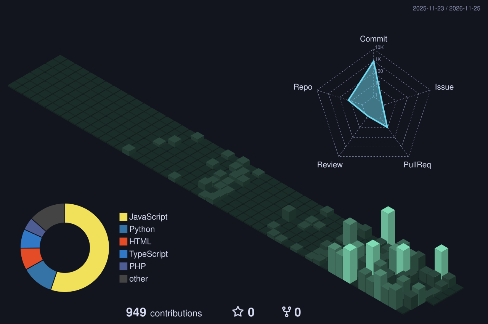

<h1 align="center">Diego Andrés Meza Rodríguez</h1>

Estudiante de Ingeniería de Sistemas/Software (UNAB) · 📍 Bucaramanga, Colombia · Abierto a prácticas

---

## 🧠 Sobre mí

Estudio Ingeniería de Sistemas/Software en la UNAB. Construyo aplicaciones web y móviles de punta a punta, y me interesa la arquitectura de software y la integración de LLMs en productos reales. Mi meta es convertirme en **Software Architect / Tech Leader**.

* 🔭 **Ahora mismo:** integro LLMs en aplicaciones con *Prompt Engineering* y estudio patrones de diseño para sistemas distribuidos.
* 💬 **Hablemos de:** Django, IA aplicada y arquitectura de software.

> 🌎 **English:** Systems Engineering student at UNAB. I build full-stack web and mobile apps and integrate LLMs into real products. Interested in software architecture. Open to internships and collaborations.

---

## 🚀 Proyectos

> **🟢 Live · [Scrumter](https://scrumter.io)** 
> Gestión de proyectos Scrum con IA: backlog, historias, sprints y Kanban. 
> **Rol:** Co-autor. 
> `React` `TypeScript` `Vite` `Tailwind` 
> [Demo de Scrumter](https://scrumter.io) · [Repo de Scrumter](https://github.com/darman-prog/scrumter_landing_page)

> **🟢 Live · [Nubi](https://nubi-six.vercel.app)** 
> PWA de higiene del sueño para adolescentes, con contenido basado en evidencia. 
> `React` `TypeScript` `Vite` `PWA` 
> [Demo de Nubi](https://nubi-six.vercel.app) · [Repo de Nubi](https://github.com/darman-prog/Nubi)

> **🟢 Live · [Systematic](https://systematic-iota.vercel.app)** 
> App de estudio con quiz, simulacros, flashcards y repaso espaciado. 
> `TypeScript` `Vite` `Tailwind` `Firebase` 
> [Demo de Systematic](https://systematic-iota.vercel.app) · [Repo de Systematic](https://github.com/darman-prog/Systematic)

> **🟢 Live · [Atlas Mágico](https://atlasmagicop.netlify.app/)** 
> Juego educativo de geografía y trivia por país con gamificación. 
> `React` `TypeScript` `Vite` `Netlify` 
> [Demo de Atlas Mágico](https://atlasmagicop.netlify.app/) · [Repo de Atlas Mágico](https://github.com/darman-prog/atlas-magico)

> **⚙️ [Teiba](https://github.com/darman-prog/Teiba)** 
> Proyecto full-stack con backend en FastAPI y frontend en React. 
> `FastAPI` `React` 
> [Repo de Teiba](https://github.com/darman-prog/Teiba)

**También:** [EcoReceta](https://github.com/darman-prog/EcoReceta) (Android · Kotlin) · [OpenCodeConfig](https://github.com/darman-prog/OpenCodeConfig) (harness de agentes).

[Ver todos los repositorios →](https://github.com/darman-prog?tab=repositories)

---

## ⚙️ Stack

**Backend** 

**Frontend** 

**Mobile y datos** 
 

**DevOps** 

**Arquitectura** 
   

**IA y agentes** 
 

---

## 📡 Mi Tech Radar Personal

| Tecnología | Estado | Justificación |
|:-----------|:-------|:--------------|
| Django + DRF | ✅ Adopt | Base sólida de mis proyectos backend |
| Arquitectura por capas | ✅ Adopt | Separación de responsabilidades y mantenibilidad |
| Arquitectura hexagonal | 🧪 Trial | Aislamiento del dominio con puertos y adaptadores |
| Diseño guiado por el dominio (DDD) | 🧪 Trial | Modelado del dominio y lenguaje ubicuo |
| FastAPI | 🧪 Trial | Microservicios de alto rendimiento con IA |
| Docker | 🧪 Trial | Containerización de mis aplicaciones |
| Kubernetes | 📋 Assess | Próximo paso para escalar sistemas |

> 💡 *Adopt = lo uso a diario · Trial = lo estoy probando · Assess = lo estoy investigando*

---

## 📊 Actividad

### 🌐 Gráfica 3D: contribuciones del último año

  

### 🐍 Snake de contribuciones

  

---

## 📫 Contacto

**¿Te interesa colaborar?** 
Estoy abierto a prácticas, proyectos open-source y colaboraciones técnicas.

[📩 damezago24@gmail.com](mailto:damezago24@gmail.com) · [💼 LinkedIn](https://www.linkedin.com/in/diego-andres-meza-rodriguez-b50078302/) · [📸 Instagram](https://instagram.com/dameza24)

